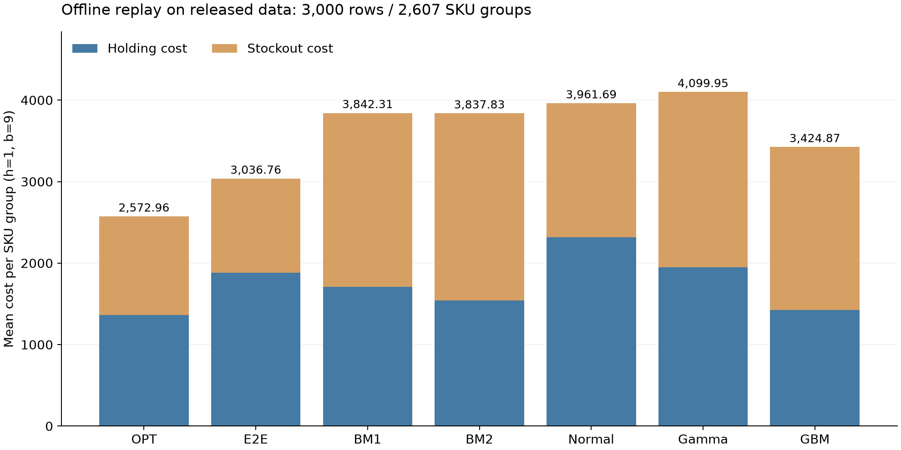
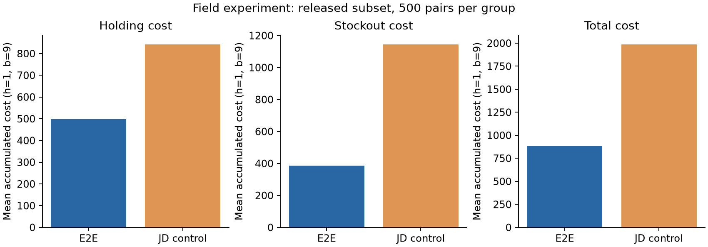
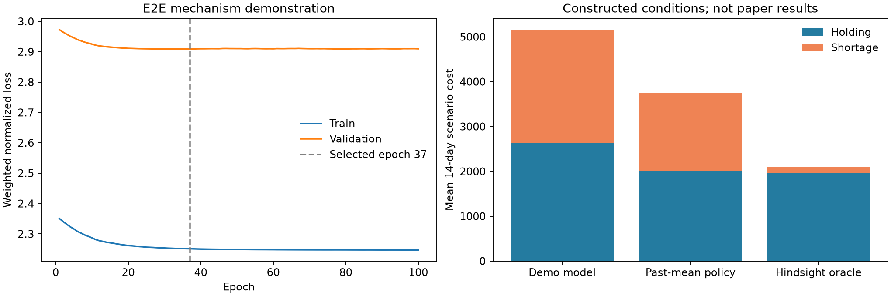

# 《A Practical End-to-End Inventory Management Model with Deep Learning》复现报告

**结论：已重算作者公开数据范围内的离线评估和现场统计，并独立核对当前作者源码；完整私有训练实验无法由公开包精确恢复。** 离线 E2E/GBM 的预测来自作者 CSV，本次没有将这些预生成预测冒充为重训所得。模型训练演示另列。

论文：Qi et al., Management Science 69(2), 759–773，DOI 10.1287/mnsc.2022.4564。来源为用户提供的论文和 ZIP，无外部替代数据。报告生成时间：2026-10-25T02:43:10.354112+08:00（北京时间）。

## 1. 完成范围和验证

| 内容 | 本次完成 | 边界 |
| --- | --- | --- |
| 离线比较 | 重算7种方法、21个平均成本值；与缓存在六位小数舍入精度一致 | 公开CSV有3,000行、2,607个唯一SKU标识；不是完整24,333 SKU实验 |
| 现场实验 | 四组各500行的均值、t检验、OLS与DiD统计；匹配诊断 | 是公开子样本重算，未重复真实京东现场干预 |
| 模型实现 | 可训练MQRNN+VLT+融合模型、定理1标签、联合损失、权重保存 | 缺失特征、库存、交货期和损失细节有明确假设；仅机制演示 |
| 审计 | 作者文件逐字节校验、依赖版本、源码与数据哈希、独立源码等价检验 | 原论文表格仅作参照，不写入“本次计算”列 |

独立验证通过：7种方法×2,607组完整库存曲线及计费曲线、21个离线均值；现场12,000个逐行指标、10个实验后t/p、60个OLS系数/标准误/t/p、15个DiD点估计/t/p。详见 [source_equivalence.json](source_equivalence.json)。保留了 28 个原始作者文件，校验记录在 [provenance.json](provenance.json)。

## 2. 离线结果：公开样本

按作者 notebook 的库存模拟与计费规则计算，h=1、b=9；成本是每个SKU组的累计成本均值，不是每天成本。表中相对下降按 `1-E2E成本/比较方法成本` 计算；OPT为事后参照。

| 方法 | 总成本 | 持有成本 | 缺货成本 | E2E相对该方法总成本下降(%) |
| --- | --- | --- | --- | --- |
| OPT | 2572.96 | 1363.22 | 1209.75 | -18.03 |
| E2E_RNN | 3036.76 | 1883.59 | 1153.17 | 0.00 |
| Bm1 | 3842.31 | 1709.36 | 2132.94 | 20.97 |
| Bm2 | 3837.83 | 1541.63 | 2296.20 | 20.87 |
| Normal | 3961.69 | 2317.10 | 1644.59 | 23.35 |
| Gamma | 4099.95 | 1947.84 | 2152.11 | 25.93 |
| gbm | 3424.87 | 1424.93 | 1999.94 | 11.33 |



21项成本与作者保存的六位小数结果的最大绝对差为 4.78e-07。E2E相对GBM总成本下降 11.33%。论文全量 E2E/OPT 成本分别为3766.52/3022.60，公开样本为3036.76/2572.96；数值不同是比较范围不同，不能称作完整数值精确复现。

必须保留的代码口径：初次到货前的库存不计入这里的成本；补货可能为负；到货时负库存被重置；SKU内部沿CSV顺序模拟，文件不含时间戳，无法另行验证排序。`vlt`字段在README与原日志中的语义不一致。以上均在忠实重算中保持，不直接等同于理论完全积压库存模型。

Normal基准的公开代码使用 `Z90=1.64`，其方差项也不同于论文式(7)。单独按式(7)替换正态公式、其余仿真不变时，Normal平均总成本从 3961.69 变为 3925.87。这只是公式敏感性，主表仍按作者代码。详见 [normal_formula_sensitivity.csv](offline/normal_formula_sensitivity.csv)。

## 3. 现场统计：公开500行子样本

下表按作者 notebook 使用 h=1、b=9；正文现场单价为h=12、b=88。二者并非相同比例缩放，已另存论文单价敏感性附表。库存路径长度不统一，成本计 `test_inv[:-1]`，缺货率分母仍用完整路径长度；周转为平均库存/平均需求，越小越好。

| 指标 | E2E组 | 对照组 | 相对下降(%) | 双侧t检验p值 |
| --- | --- | --- | --- | --- |
| 持有成本 | 497.990000 | 841.428000 | 40.816089 | 8.18e-14 |
| 缺货成本 | 386.100000 | 1143.720000 | 66.241737 | 2.01e-14 |
| 总成本 | 884.090000 | 1985.148000 | 55.464781 | 1.07e-30 |
| 周转指标(库存/需求) | 12.268705 | 18.471056 | 33.578760 | 5.46e-08 |
| 缺货率 | 0.108270 | 0.236529 | 54.225473 | 1.23e-16 |



子样本也并非所有回归结论都重现：无截距OLS中，周转指标E2E系数为 0.3458、p=0.7698；论文完整样本系数为-1.16、p=.007，不能声称这里获得同样的显著改善。OLS和t检验按作者定义重算，不单独赋予新因果解释。

### DiD点估计及缓存审计

| 指标 | E2E前 | E2E后 | 对照前 | 对照后 | DiD | 作者检验口径p值 |
| --- | --- | --- | --- | --- | --- | --- |
| 持有成本 | 666.394000 | 497.990000 | 506.460000 | 841.428000 | -503.372000 | 8.24e-17 |
| 缺货成本 | 815.868000 | 386.100000 | 473.130000 | 1143.720000 | -1100.358000 | 3.87e-20 |
| 总成本 | 1482.262000 | 884.090000 | 979.590000 | 1985.148000 | -1603.730000 | 1.45e-41 |
| 周转指标(库存/需求) | 15.487857 | 12.268705 | 15.152613 | 16.926156 | -4.992695 | 0.004645 |
| 缺货率 | 0.236133 | 0.108270 | 0.197525 | 0.236529 | -0.166867 | 3.45e-14 |

历史缓存 45/55 项匹配，10 项不匹配。不匹配项来自 DiD 的 t 值和 p 值。独立执行原 notebook 的当前源码和公开 CSV，得到与本次脚本相同的结果；公开资料不足以确认历史缓存差异的原因。缓存不作为改变算法或扩大容差的理由。

这里的显著性计算忠实原 notebook：按文件行顺序求处理减对照，再对前后两个差值序列做独立样本t检验；不是带个体固定效应、聚类标准误的面板DiD估计。原完整样本日志还存在三项前期变量复制错误，已在审计笔记记录；本次没有沿用这些错误来追求论文p值。

匹配程序先拟合logistic propensity score，但作者实际在未标准化的需求、交货期及组指示列上做有放回最近邻，而非按propensity score做匹配。保留该实现并输出 [匹配诊断图](field/matching_propensity.png)。候选匿名索引无法可靠对应现成控制组轨迹，因此匹配演示不冒充恢复控制组身份。

补充文件：[按论文单价的现场成本](field/sensitivity_post_comparison_h12_b88.csv)、[带截距OLS](field/sensitivity_ols_with_intercept_h1_b9.csv)、[缓存差异逐项记录](field/notebook_output_verification.csv)、[现场详细报告](field/field_report.md)。

## 4. 可训练模型：机制演示，不是论文全量重训

根据图1和公开模块实现了需求 MQRNN、交货期 MLP、决策融合 MLP 和三项联合损失。保留默认 hidden=50、VLT层50/20、融合层100/100、dropout=0.2、SGD学习率0.001、momentum=0.85、batch=64、高斯初始化。保密的损失和特征由显式配置补全，不能据此恢复私有模型。

实际观察数据仅为5条公开销量序列、每条457天。交货期固定3天、到货间隔14天、初始库存由过去28天均值构造；这些条件都是演示假设。历史窗口60天、预测21天、分位数0.1/0.5/0.9；周特征为相对日序的正余弦。不同日期的场景独立生成库存，成本不是连续库存仿真的运营收益。

按时间60%/20%/20%划分，训练/验证/测试样本数分别为 970/355/360。未来标签窗口不跨分区边界，缩放只拟合训练期。训练 100 轮；依据验证损失选择第 37 轮，不用测试集选模型。

- 定理1标签在 250 个随机小例上用凸成本折点穷举核验，最大目标差 0。
- 梯度存在且有限，参数已更新，训练损失下降；保存/恢复模型预测最大差 0。
- 测试最优订单标签 MAE=140.200，RMSE=172.603。

以下仅为假设条件下的14天到货区间成本，不与论文图2比较：

| 方法 | 持有成本 | 缺货成本 | 总成本 |
| --- | --- | --- | --- |
| model | 2637.029 | 2511.081 | 5148.110 |
| past_mean | 2006.259 | 1743.298 | 3749.557 |
| oracle | 1970.739 | 128.333 | 2099.072 |

本演示模型未优于过去均值基准，因此不支持将这组小样本训练结果写成论文性能结论；它验证的是模型、标签和训练流程确实可运行。



模型权重在 [best_validation.pt](model_demo/best_validation.pt)，配置与假设在 [config.json](model_demo/config.json)，全部训练记录在 [training_history.csv](model_demo/training_history.csv)。

## 5. 怎样运行和继续研究

当前文件夹已准备好本地Python环境。在PowerShell进入项目文件夹运行：

```powershell
./run_reproduction.ps1
```

只重算公开评估、不运行训练演示：

```powershell
./run_reproduction.ps1 -SkipDemo
```

移到其他电脑后，使用Python 3.12运行 `setup.ps1 -Python "你的python.exe绝对路径"` 安装固定版本依赖，再运行以上命令。已安装环境记录在provenance.json；入口将各阶段输出保存至results/logs，任何源码等价核验失败都会停止。

主要代码：`scripts/reproduce_offline.py`（离线）、`scripts/reproduce_field.py`（现场）、`scripts/train_demo.py`（训练演示）、`scripts/verify_source_equivalence.py`（原源码独立对照）。作者包原文件位于author_package，论文副本在paper/source_paper.pdf。

要做原论文全量训练与附录敏感性实验，仍需：完整132维训练/验证/测试特征及时间索引、匹配一致的销量/库存/订单/VLT表、保密预处理与标签规则、完整损失及辅助权重、分位设置和原随机种子/权重。可直接用这些真实数据替换演示的数据构造层，再按时间切分训练；不能将模拟条件所得曲线替换为论文复现结论。

研究细节见 [实验规格与原文参照](../paper/experiment_spec.md) 和 [模型代码审计](../paper/model_audit.md)。
